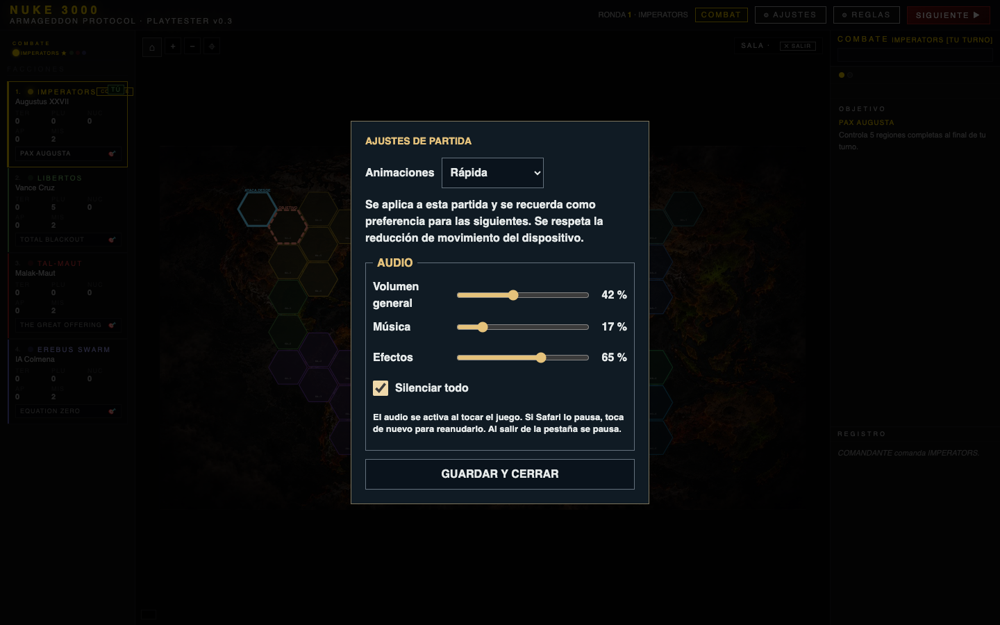
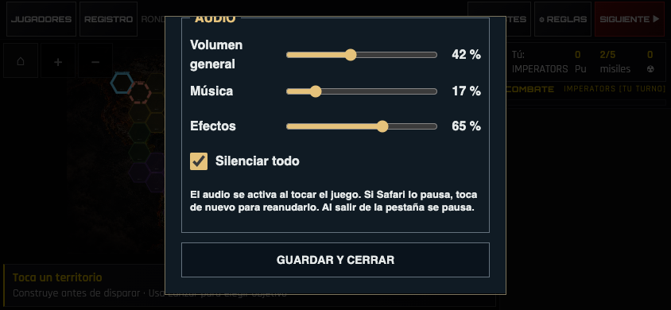

# Verificación de audio V10

`npm run test:all` terminó con código 0 el 29-10-2026, sobre la base `24a8c32`, en una copia aislada de `main`. Node 22.23.3, Playwright 1.63.0 y Chrome, sin instalar dependencias adicionales. Firebase y servicios externos bloqueados; transporte de dos clientes controlado. La reproducción histórica del bloqueo de ataques es una prueba positiva de la versión antigua, no un fallo de la entrega.

- 343 tests de motor: 343 pasan, 0 fallan.
- Cuatro E2E completos, sin mutar el estado desde los tests: V3 escritorio/táctil, victoria Libertos en ronda 12 (121 acciones UI); V4 escritorio/táctil, victoria Libertos en ronda 5 (61 acciones UI).
- Navegación, decisiones remotas, dos clientes V3/V4, interfaz responsive, sorteo/desempate online, figuras persistentes, ciclo de vida y omisión de cinemáticas.
- Tablero SVG original, diferencias geométricas significativas: 0 en escritorio y 844×390.
- Ocho misiles: impacto/intercepción, con/sin base nuclear, escritorio/táctil; dados y bajas autoritativos.
- Actualización real de service worker V9→V10: eliminación de caché previa, SHA256 de 70 recursos y arranque offline con 60 territorios.

[Resumen de la batería](regression-summary.txt) · [Mediciones de audio](audio-report.json).

La prueba específica usa Web Audio real, no un reproductor simulado. Antes del gesto no existe AudioContext. Decodifica los 17 MP3 y los 17 OGG en escritorio; en móvil fuerza un fallo del MP3 de dados para comprobar respaldo OGG. Comprueba señal PCM no nula, una única fuente ambiental entre dados, turnos, batallas y misiles, los efectos conectados, aborto/omisión, suspensión y reanudación conservando la fuente, controles y preferencias tras recarga, silencio, reducción de movimiento, victoria/derrota una sola vez y arranque sin API de audio. Las escenas usan fixtures de resultados resueltos; se prohíbe consumir RNG durante su presentación.

Dos clientes reciben el mismo dado remoto, su repetición y una nueva repetición después de 130 presentaciones intermedias: cada cliente lo reproduce una sola vez. Reabrir el mismo combate tampoco duplica sus sonidos. Esto comprueba replay/reconexión simulada; no certifica Firebase real.

La mezcla con todos los volúmenes al máximo y disparos/explosiones superpuestos mantiene seis voces y dos disparos como máximo. Pico PCM medido tras compresión: 0.949 escritorio y 0.865 móvil, sin alcanzar ±1 en el escenario probado. No sustituye una revisión auditiva artística ni garantiza todas las combinaciones futuras.

Pendiente: validación de escucha y reanudación en Safari/iPhone físico, volumen del dispositivo e interrupciones reales por llamada/bloqueo. Chrome con viewport táctil no certifica estos comportamientos de iOS. Ver [contrato de integración y sonidos](../../AUDIO.md).
