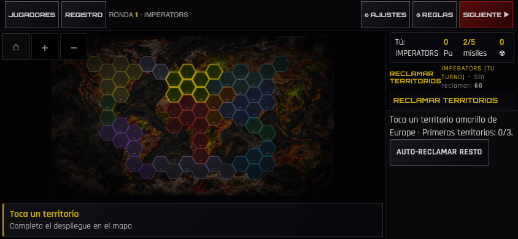
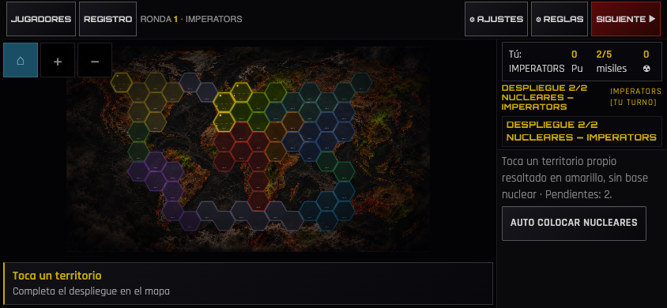

# Reclamación manual, nucleares y zoom V12

Informe del 29-10-2026. Base `7fd4643`; Node22, Playwright y Chrome. Escenarios locales aislados, sin Firebase ni servicios externos. No se ha usado Safari/iPhone físico.

## Comprobado

- Motor: 343/343 tests pasan. Reclamación inválida conserva callback, turno, recursos y reserva de origen; una elección válida avanza una vez.
- `test:setup-map`: seis facciones × escritorio 1440×900 y táctil 844×390. Cuatro reclamaciones físicas por escenario: 48 en total, incluyendo las tres de origen y una en otra región. Destinos inválidos muestran indicación visible y no consumen turno.
- Dos nucleares manuales por escenario de las cinco facciones con bases: 20 en total. Libertos conserva cero bases iniciales. No se invocan botones automáticos para reclamar o colocar las bases de estas pruebas.
- Entrada táctil: pérdida temprana de captura y click compatible sin duplicado; SVG hit-test que devuelve el contenedor en lugar del territorio; una comprobación adicional fuerza rechazo de `setPointerCapture` y completa la selección sin errores. Estas condiciones se simulan de forma controlada: no reproducen físicamente Safari.
- Zoom: botones, ajuste completo, pellizco real mediante CDP, arrastre con el dedo restante y conservación del centro/ampliación relativa al cambiar altura. Pellizcar no reclama territorios.
- Regresión UX: 1440×900, 844×390, 667×375, 932×430 y 390×844; combate, movimientos, refuerzos y despliegue manual. Dos clientes V3/V4, escritorio y táctil, con transporte controlado.
- E2E V4 táctil completo: victoria Libertos en ronda 5, 61 acciones UI y cero mutaciones del estado desde el test.
- Ciclo cinematográfico: intercepción, nuclear y cancelación correctos. Actualización V11→V12 del service worker, hashes de 70 recursos y arranque offline correctos.
- Comparación visual: cero diferencias fuera de elementos variables ya identificados. Durante la primera comparación hubo un tooltip de hover y diez píxeles del halo animado del LED fuera de la máscara. Se retira el hover antes de capturar y se amplía la máscara del halo dos píxeles tras medir sus coordenadas (39..48, y=114). La comparación posterior pasa; no se altera el mapa para ajustar el test.

[Registro de comprobaciones](checks.txt).

## Corrección

El toque conserva su territorio desde `pointerdown` y se completa desde `pointerup` del documento, aun cuando SVG pierda o rechace captura. Cancelar, arrastrar o pellizcar no selecciona. El mapa conserva los destinos permitidos al redibujar: antes, `updateMap` sobrescribía los resaltados de reclamación y nucleares. La interfaz explica las restricciones V4 y responde a destinos inválidos.

El observador de tamaño ya no fuerza ajustar el mapa completo en cada cambio de alto. Conserva centro y zoom relativo. El botón Inicio/centrar mantiene el ajuste completo explícito.

Pendiente: validar en el iPhone del usuario el síntoma reportado y la interacción con las barras e interrupciones reales de Safari. La reclamación legal ya funcionaba en Chrome antes del cambio; no se atribuye el síntoma físico a una causa de Safari confirmada sin reproducirla en ese dispositivo. Reglas V4, geometría, audio y resultados permanecen intactos.
